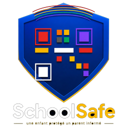

# SchoolSafe - Studio de cartes uniquement

Ce paquet contient les deux generateurs recto/verso d'origine, les 21 familles,
les palettes scolaires, les modeles ecole/classe/eleve/selection, les bandeaux,
les patrimoines avec leurs provenances et credits, ainsi que le logo anime.
Il ne contient pas l'application SchoolSafe complete, Rosario, Supabase,
l'authentification, les secrets ou l'emission de cartes officielles.

## Apercu
Servir ce dossier avec un serveur HTTP statique et ouvrir index.html.
Les dossiers de demonstration sont fictifs. Les modeles et couleurs sont
enregistres localement dans le navigateur, pas dans une base de production.

## Integration
La barre de preparation propose un eleve, une salle de classe ou toute
l'ecole. La preparation par classe filtre les eleves par cid et utilise
le modele resolu pour chaque eleve. responsive.css et studio-responsive.js
adaptent les commandes tactiles et la taille des apercus, sans modifier
les dimensions imprimees. Vues navigateur testees : 320, 390 et 1280 px ;
aucun telephone physique n'a ete utilise.

host-adapter.js est l'adaptateur de demonstration a remplacer par les donnees
de l'application. Appeler SchoolSafeStudio.setData avec :

```js
SchoolSafeStudio.setData({
  settings: {year: '2026-2027', school: {name: 'Mon ecole', motto: 'Ma devise', logo: '/logo-ecole.png'}},
  classes: [{id: 'classe-1', name: '3e Primaire', cycle: 'primaire', card_pat: 'rdc-okapi'}],
  students: [{id: 'eleve-1', cid: 'classe-1', name: 'Nom Postnom Prenom', mat: '001', dob: '2017-01-01', photo: '/photo.jpg', pid: 'parent-1'}],
  users: [{id: 'parent-1', name: 'Parent', phone: ''}],
  aps: []
});
```

Ne transmettre que les donnees de l'ecole autorisee. Ajouter validation et
controle des droits cote application. Remplacer les cles localStorage par
des cles tenant/ecole avant usage multi-ecole. Les changements de modele
ne sont pas des emissions officielles : les QR actuels schoolsafe://student
sont des identifiants de demonstration, pas des QR signes de production.
Le systeme d'emission, signature et verification appartient a l'application
fonctionnelle et doit rester separe de la creation graphique.

## Logo anime
Le verso remplace le sceau par schoolsafe-seal.jpg (logo fourni par le
proprietaire) et le slogan SchoolSafe. Les signatures, la note de securite
et l'ancien pied de page du verso sont retires. Six couleurs de texte sont
reglables dans le studio, ainsi que les coordonnees de l'ecole.

Utiliser logo-schoolsafe.png avec logo-anime.css :

```html

```

L'animation couleur et le mouvement sont CSS, pas un GIF. Le reglage
prefers-reduced-motion est respecte.

## Droits et limites
Disposition et impression : studio-layout.js permet le deplacement et le
redimensionnement par poignees, ou par champs numeriques. Les informations
et libelles se reglent par groupe ; les positions sont des decalages par
rapport au flux d'origine. Les reglages sont communs a chaque format
(vertical/horizontal), pas encore propres a chaque modele ecole/classe.
La prochaine integration doit les rattacher aux modeles si des mises en
page differentes sont souhaitees par classe.

Largeurs proposees : vertical 54 mm, horizontal 85,6 mm ; hauteur calculee
avec les proportions du dessin. Ce sont des valeurs modifiables, non des
mesures validees d'un support client. L'apercu en mm n'est pas une calibration
physique du moniteur. Les feuilles d'impression appliquent les dimensions
par CSS ; imprimer a 100 %, sans ajustement de page, puis mesurer sur papier.
Les textes sous 6 pt et certains debordements sont signales ; ce controle
ne detecte pas toutes les collisions entre elements. Le QR n'est pas un
element editable. Tester lecture des QR sur les supports imprimes.
Le logo schoolsafe-seal-white.png est une variante sur fond blanc derivee
du logo fourni, a faire valider par le proprietaire de la marque.

Conserver les credits et sources de studio-heritage-origins.js.
Kuba : Brooklyn Museum, CC BY 3.0 ; Kongo/Luba/Teke : The Met, domaine public ;
Lunda : Andreas Praefcke, domaine public. D'autres fonds sont illustratifs.
Les droits du code et du logo SchoolSafe doivent etre confirmes par leur
proprietaire avant redistribution. QRCode.js est livre avec sa licence MIT.
L'export est une preparation HTML pour impression/PDF, pas un fichier ZIP
de cartes, malgre le nom historique exportSSAllCardsZip.
Verifier impression, longueurs extremes, mobiles et QR de production lors
de l'integration. Aucune connexion de production n'est fournie.
